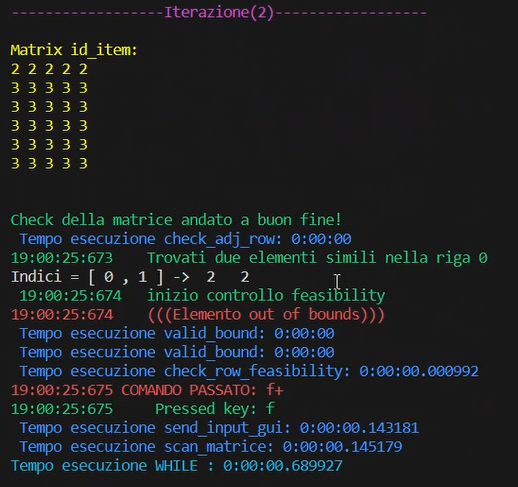
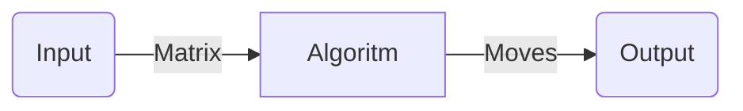
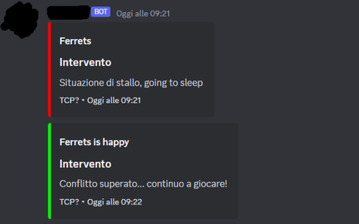
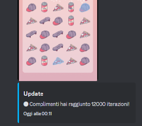
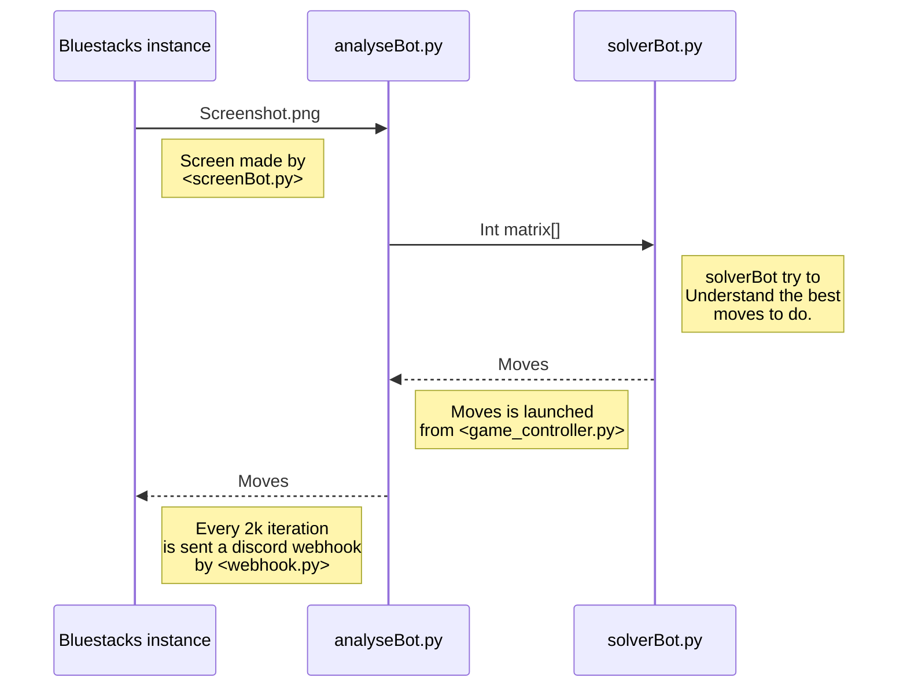

# What is "Automatic Game Solver"

It a software that is able to autonomously play an online game, using pixel analisys and decision making algoritms.
It is a 100% *Python* software.

## Dependencies

· Windows 10/11  
· Python ( Version > 3.0)  
· Bluestacks (10.0) -> [Bluestacks download](https://www.bluestacks.com/it/index.html)  
· Pip3 package manager  

  
  
## Main features

### 1. Pixel analisys

Made with OpenCV, is able to recognise the different between object in a specific set.

</img>

### 2. Game solver

Algorithm that takes an input matrix of objects and returns the best move.



### 3. Game controller

Create macro, using *pyautogui*, that can make the moves in the game.


### 4. Notification interface

Using Discord Webhook the bot is able to update his status.  

<br>
<p> Log - Notify </p>
</img>

<br>
<p> Update - Notify </p>
</img>


## Modules interaction

· Each module is called from Main.py


## Real-time recognition technique 
The real-time recognition technique is the key innovation of the system. By designing a constant-time (≈ O(1)) object recognition strategy instead of relying on heavier computer vision pipelines, we achieved **high-speed decision** cycles under strict constraints. 

This which was necessary because:
- we do not have access to the application’s source code
- all state must be inferred directly from pixels
- latency between “seeing” and “acting” must be minimal

## How to Set Up New Hardware 

⚠️ **Alert** : It is no longer possible to try the software because the game it depends on is no longer available.

### Step 1 (Library Configuration)

1. Type `python3` in PowerShell and install Python from the Microsoft Store.
2. Run:

   ```bash
   pip install --upgrade pillow
   ```
3. Install the required libraries:

   ```bash
   pip3 install -r requirements.txt
   ```

   (This downloads all the project dependencies.)

---

### Step 2 (Visual Studio Code Setup)

1. Take a screenshot with the app open in fullscreen using **/Tools/screen_help.py** (option = 1).
   The image will be saved as:

   ```
   /Screenshot/screenshotFull.png
   ```

2. Once you have the fullscreen screenshot, move it to the Desktop.

3. After moving it to the Desktop, run **/Tools/screen_help.py** again (option = 2) and open the previously created fullscreen image.

4. By adjusting the parameters `set_grill (x, y)` and `square_side`, generate the file:

   ```
   output.png
   ```

5. Using Paint, analyze **output.png**.
   You should aim to have a dot positioned in the same exact spot for every item.

6. Provide **Package/analyseBot.py** with the image `output.png` that appears to have the best grid configuration.
   (REMEMBER TO UPDATE THE PARAMETERS.)

---

### Step 3 (Bluestacks Setup)

1. Go to Settings and remove `CTRL+M` from the shortcuts.
2. Import the Macros.
3. Modify the last three Macros:

   ```
   Alt+5
   Alt+6
   Alt+7
   ```

---

### Step 4 (Starting Bot Options)

When you start the bot, you will see two options:

1. `'s'` → Starts the bot and runs **8000 iterations by default**, then restarts a new game.
2. `'e'` → Immediately ends the current game and then starts new games with **8000 iterations**.

---

### Step Extra (Using a Virtual Environment)

If you want to use a virtual environment, here is how to set it up:

1. Install virtualenv:

   ```bash
   pip3 install virtualenv
   ```
2. Create a virtual environment:

   ```bash
   python3 -m venv /path/to/new/virtual/environment
   ```
3. Set execution policy (Windows):

   ```bash
   Set-ExecutionPolicy -ExecutionPolicy RemoteSigned -Scope CurrentUser
   ```
4. Activate the virtual environment:

   ```bash
   .\Scripts\activate
   ```
5. Install the required libraries:

   ```bash
   pip3 install -r requirements.txt
   ```
6. Save installed libraries (optional):

   ```bash
   pip3 freeze > requirements.txt
   ```
7. Deactivate the virtual environment:

   ```bash
   .\Scripts\deactivate
   ```


